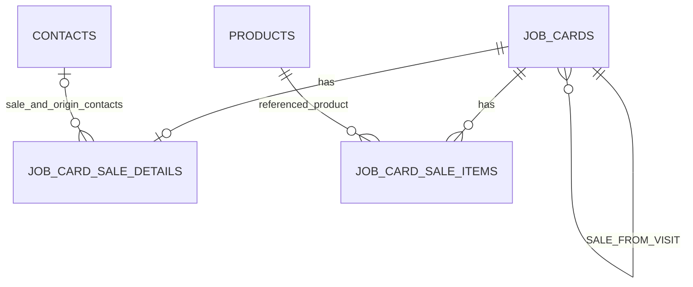

> See [the PR1 contract and handoff](README.md) for implementation status. Approved for PR1 implementation on 2026-10-14. The user confirmed IN_PROGRESS sources, four engagement kinds, BUSINESS records, optional sale contact, NEW/ACCEPTED creation and the terminal-slot policy. Original discovery documents remain untouched. PR2–PR4 behavior is a design target, not shipped behavior. Evidence references below describe the original discovery bundle.

# Visit-to-Sale — Data, Lifecycle and Concurrency Contract

Date: 2026-10-14 (Europe/Istanbul)
Baseline: `daf5a59692803f9e5acbbef431d12cc32e1c02e3`
Status: Approved V1 design. Baseline facts below describe discovery; PR1 implementation boundary is recorded in [README](README.md).

Ürün kararları [design](visit-to-sale-design.md) içindedir. Bu sözleşmede “öneri”, yeni uygulama hedefidir; mevcut kaynak davranışı değildir. Kullanıcı kararı: aynı ziyarette en fazla bir aktif satış.

## 1. Doğrulanmış migration head

Canonical `server/src/db/migration-catalog.ts` içindeki gerçek `loadMigrationCatalog` fonksiyonu, archive edilmiş SHA'nın `server/src/db/migrations` dizini üzerinde çalıştırıldı. Fonksiyon yalnız dosya kataloğu okur; DB başlatmaz/migrate etmez.

Sonuç: **56** kayıt, contiguous **001–056**, head **`056_meeting_met_contact`**, dosya **`056_meeting_met_contact.sql`**. `Original discovery bundle evidence: migration-catalog-evidence.json` sonuçları saklar. Bu, live/production DB'nin applied head iddiası değildir.

Gelecek PR'da rebase sonrası katalog yeniden yüklenir. Henüz yeni migration numarası veya filename rezervasyonu yoktur. Draft SQL aşağıda numarasızdır. Applied 002/005/007/022/049/051/056 dosyaları değiştirilmez.

## 2. Önerilen şema



Bu şema yeni normal JobCard'ı subtype verisiyle derinleştirir. Delivery items/meeting details yeniden adlandırılmaz veya satış alanlarıyla genişletilmez. İlişki türü API'de explicit `SALE_FROM_VISIT`, persistence'ta yalnız SALE'e ait ayrı FK alanıdır.

### 2.1 `job_cards`

Yeni nullable `sale_source_visit_id UUID`; composite FK `(organization_id, sale_source_visit_id) → job_cards(organization_id, id) ON DELETE RESTRICT`. Self-link CHECK. SALE'de source zorunlu; diğer türlerde null. SALE'de customer zorunlu; `contact_id`, `engagement_kind`, `source_job_card_id` ve bütün follow-up proposal/instruction alanları null. `scheduled_at`, `scheduled_ends_at`, `due_date` null; gerçekleşme zamanı sale details'tadır.

`job_cards_type_check` mevcut dört tür korunarak SALE ile genişletilir. Aktiflik için yeni boolean/status üretilmez. Önerilen kuralın çekirdeği:

```sql
-- Design draft only; put in a new migration after rechecking catalog head.
CHECK ((type = 'SALE') = (sale_source_visit_id IS NOT NULL));
CHECK (sale_source_visit_id IS DISTINCT FROM id);

CREATE UNIQUE INDEX job_cards_one_active_sale_per_visit_idx
ON job_cards (organization_id, sale_source_visit_id)
WHERE type = 'SALE'
  AND status IN ('NEW', 'ACCEPTED', 'IN_PROGRESS',
                 'WAITING_APPROVAL', 'REVISION_REQUESTED');
```

Historical child listing için `(organization_id, sale_source_visit_id, created_at DESC, id DESC)` partial read index. `COMPLETED`, `CANCELLED`, `INVALIDATED` slotu serbest bırakır. Statü değişirken index otomatik güncellenir; ayrı slot update'i veya trigger ile duplicate state senkronizasyonu gerekmez. Status kümesi DB/app contract test'iyle canonical `ACTIVE_JOB_CARD_STATUSES` ile eşlenir.

Kaynağın `SALES_MEETING` olması, eligible engagement/status ve create-time customer eşitliği cross-row kurallardır: backend source row lock altında doğrular. CHECK/FK bunları tek başına garanti ediyormuş gibi raporlanmaz. Origin FK ve sale customer uygulama üzerinden immutable'dır; genel PATCH allowlist'ine alınmaz. İlk slice standalone SALE veya SALE follow-up desteklemez.

### 2.2 `job_card_sale_details` — parent başına tek kayıt

| Alan | Tip / sözleşme |
| --- | --- |
| `organization_id`, `job_card_id` | Organization FK + parent composite FK; `job_card_id` PK veya `(organization_id, job_card_id)` unique; parent SALE olmalı (service). |
| `sold_at` | `TIMESTAMPTZ NOT NULL`, finite instant. Actual sale time; scheduled/meeting/approval timestamp'tan türetilmez. |
| `sale_contact_id` | Nullable composite Contact FK. Satış sırasında görüşülen kişi; formun optional açık seçimi. |
| `sale_contact_name_snapshot`, `sale_contact_title_snapshot` | Nullable name/title; seçildiği veya değiştirildiği sıradaki değer. Null contact'ta ikisi de null. |
| `source_visit_version` | Positive integer; bağlantı kurulduğundaki source version. Canlı concurrency version değildir. |
| `source_visit_title_snapshot` | Non-blank VARCHAR(255); immutable origin label. |
| `source_customer_name_snapshot` | Non-blank VARCHAR(255); sale müşteri ID'si parent'ta korunur. |
| `source_planned_contact_id` | Nullable composite FK; kilitli ziyaretin `contact_id` değeri, sale contact değildir. |
| `source_planned_contact_name_snapshot`, `source_planned_contact_title_snapshot` | Source planned identity; isim/title sınırları contacts ile eşlenir. |
| `source_met_contact_id` | Nullable composite FK; canonical meeting details `met_contact_id`. |
| `source_met_contact_name_snapshot`, `source_met_contact_title_snapshot` | Persisted source met identity. Planned identity'den fallback yok. |
| `created_at`, `updated_at` | Sunucu kayıt zamanları; `sold_at` değildir. |

Parent version tek edit/concurrency otoritesi; subtype için ikinci optimistic version yoktur. Origin snapshot'ları değişmez; sale contact snapshot'ı ancak idempotent açık contact değişikliğinde değişir. Kişi adının katalog/CRM'de değişmesi historical snapshot'ı yeniden yazmaz.

### 2.3 `job_card_sale_items`

| Alan | Tip / sözleşme |
| --- | --- |
| `id` | UUID PK. |
| `organization_id`, `job_card_id` | Organization ve SALE parent composite FK, history koruyan RESTRICT. |
| `product_id` | Products composite FK; stable identity. |
| `quantity` | `NUMERIC(12,3) NOT NULL`; `1 ≤ quantity ≤ 999999999` ve `quantity = trunc(quantity)` (SALE-QTY-001, 058). NaN/Infinity, kesir ve sıfır/negatif değer kabul edilmez. |
| `product_name_snapshot` | Non-blank VARCHAR(255). |
| `product_sku_snapshot`, `product_brand_snapshot`, `product_model_snapshot` | Nullable VARCHAR(100). Aynı transaction'da ürünün canonical değerleri. |
| `unit_snapshot` | Nullable VARCHAR(30); spelling/case korunur; boş varsayılan birim üretilmez. |
| `sort_order` | Non-negative integer; kullanıcı seçiminin sırası. |
| `created_at`, `updated_at` | Sunucu zamanları. |

Unique `(organization_id, job_card_id, product_id)` product duplicate'ını DB'de engeller. Parent üzerinde ürün satırı read index'i gerekir. İlk create 1–25 distinct product; aktif draft edit sonrası 0–25 mümkün, fakat empty sale onaya gönderilemez. 25 sınırı mevcut delivery create boyutuyla aynı bounded başlangıç önerisidir; ürün kuralı olarak açıkça uygulanır.

SALE-QTY-001 (2026-10-15) bu bölümün ilk üç ondalıklı Sale sözleşmesini açıkça supersede eder. JSON quantity number pozitif tam sayıdır; create/add/correction ve readiness aynı validator'ı kullanır. Public DTO quantity integer string (`"1"`, `"15"`); birimden bağımsız ürün sayısıdır. V1 hash/persistence/audit normalizasyonu integer receipt replay için `"1.000"` olarak korunur; public sunum hash normalizasyonundan ayrıdır. Orijinal 057 ve audit payload'ları yeniden yazılmaz.

058, historical fractional row varsa fail-closed durur; otomatik yuvarlama/kırpma/silme yoktur. NUMERIC(12,3) typmod'u üç basamaktan fazla raw SQL precision'ını CHECK öncesinde yuvarlayabilir; servis tüm fractional input'u SQL öncesinde reddeder, DB CHECK persisted integer invariant'ını korur. Delivery quantity bu kararla değiştirilmez. Ayrıntı: [integer quantity policy](integer-quantity-policy.md).

Sale item'ında `delivery_purpose`, `delivered_at`, price, currency, total, stock, invoice, lot/serial/expiry veya payment alanı yoktur. Catalog referencePrice kopyalanmaz.

## 3. Customer ve contact provenance

| Hedef | Kaynak ve doğrulama |
| --- | --- |
| Sale `customer_id` | Kilitli source `customer_id`; active/prospect, same-org. Request customer override içermez. |
| İlk `assigned_to` | Source assignee; active STAFF, same-org, user row lock. Customer responsible Staff'tan veya creator'dan tahmin edilmez. |
| Planned-contact origin | Source `job_cards.contact_id`, read-only snapshot. İnaktif tarihsel referans kopyalanabilir; satış için yeni selection sayılmaz. |
| Source met-contact origin | Source meeting details `met_contact_id`; null kalabilir. Legacy opt-in response veya planned contact yerine repository truth okunur. |
| Sale contact | Optional explicit active same-customer selection. UI active source met-contact'ı başlangıç önerisi olarak seçebilir; yalnız source met null diye planned kişiyi otomatik seçmez. |

Source met contact inaktifse origin yine korunur; yeni sale contact olarak otomatik atanmaz. Form null/başka aktif kişi seçer ve bu farkı doğru etiketler. Sale contact'ı seçmek visit met contact'ı değiştirmez. Satış create'i kişiyi kaydetmek için meeting-details PATCH çağırmaz.

Sonradan inaktif olan aynı sale contact/product referansı quantity edit veya submission'ı engellemez; seçildiği anda geçerli olan historical veri korunur. Yeni ürün/kişi seçimi aktif referans gerektirir. Customer için mevcut JobCard submission eligibility korunur. Hard delete FK ile bloklanır; CRM/product `hasOperationHistory` projections ve 23503 domain-error mapping'leri yeni referansları da kapsar.

## 4. HTTP/service taslağı

| Operation | Önerilen endpoint / contract |
| --- | --- |
| Kaynak form bağlamı | `GET /api/job-cards/:visitId/sale-create-context`; source version, fixed customer/assignee, ayrı planned/met projection, allowed action/blocked reason. Genel CRM yazma yetkisi vermez. |
| Create | `POST /api/job-cards/:visitId/sales`; dedicated parser/service. Receipt `{ jobCardId, version }`. |
| Kaynağın satışları | `GET /api/job-cards/:visitId/sales?limit=20&offset=0`; source access + each child scope; historical cards dahil, bounded pagination. |
| Sale details/items | `GET /api/job-cards/:saleId/sale-details`; parent version, typed origin projection, sale contact, soldAt, bounded item list; same parent truth için tek read transaction/query snapshot. |
| Details düzeltme | `PATCH /api/job-cards/:saleId/sale-details`; `clientActionId`, `expectedVersion`, explicit soldAt/saleContactId patch. |
| Ürün ekleme | `POST /api/job-cards/:saleId/sale-items`; key/version + productId/quantity. |
| Miktar düzeltme | `PATCH /api/job-cards/:saleId/sale-items/:itemId`; key/version + quantity. productId immutable; farklı ürün remove/add işlemi. |
| Kaldırma | `DELETE /api/job-cards/:saleId/sale-items/:itemId`; body key/version. |
| Lifecycle | Mevcut accept/start/submit/approve/revision/withdraw/resume/cancel/invalidate endpoint'leri. |

Create body allowlist: `clientActionId`, `expectedSourceVersion`, `title`, optional `description`, `soldAt`, nullable `saleContactId`, `items[{productId, quantity}]`. Source ID URL'den; `type`, customerId, assignedTo, snapshots, scheduledAt, deliveryPurpose, follow-up, price/currency ve unknown keys reddedilir. Title non-blank 1–255, sale description için proposed limit 4000 code point, item referansları UUID. Mevcut generic create description parser'ı bu limiti doğruluyormuş gibi varsayılmaz; Sale parser açıkça uygular. Client action ID mevcut `requireActionId` gibi trimmed 1–255; browser UUID üretir fakat server'ın genel sözleşmesi zorla UUID'ye daraltılmaz.

`soldAt` client'ın açık actual zamanı: mevcut main ISO instant validator + injected server clock; gelecek toleransı meeting ile aynı 15 dakika önerilir. MeetingAt/scheduledAt otomatik kopyalanmaz; startedAt için fiziksel ziyaret başlangıcı olduğu varsayılıp yeni lower bound konmaz. Bu turda clock/parser veya R4 adayı değiştirilmez.

## 5. Create transaction, retry ve concurrency

1. Authenticated same-org actor, strict input parser; source ID ve expectedSourceVersion normalized intent'in parçasıdır.
2. Existing `executeCriticalAction` ile receipt claim: `(organizationId, actorId, clientActionId, operationKey='SALE_FROM_VISIT_CREATE')`. Hash discriminator `SALE_FROM_VISIT_CREATE:v1`; source ID, expectedSourceVersion, trimmed title/description, canonical soldAt, explicit saleContactId/null ve ordered normalized item array içerir. Catalog/source snapshot değerleri execution sonucu olduğundan hash'e eklenmez.
3. Fresh attempt'te source snapshot sadece lock edilecek user ID'yi bulmak için okunur. `lockAssigneesInOrder` ile user önce; sonra source `FOR UPDATE`. Lock altındaki assignee farklıysa stale/conflict ve rollback; yeni user'ı ters sırada sonradan lock etme. STAFF ownership ve expectedSourceVersion yeniden doğrulanır.
4. Source type/status/engagement, BUSINESS sınıfı, customer ve tek aktif sale guard'ı kontrol edilir. Customer → distinct contacts sorted by ID → distinct products sorted by ID kilit sırası. CRM enrichment'in customer-first + witness `FOR SHARE NOWAIT` protokolü korunur. Product snapshot query `FOR SHARE` kullanır; snapshot alma/deactivation yarışında doğrulama ile commit arası write engellenir. `FOR KEY SHARE` non-key catalog değişikliğini engellediği varsayılmaz.
5. Sale root, subtype details, bütün item snapshot'ları, audit events, assignment history ve receipt aynı transaction'da yazılır. STAFF `ACCEPTED`, management `NEW`. Sale başlangıç version'u 1; bulk initial items aynı create intent'inin verisidir, item başına yapay version tüketimi gerekmez. Source status/commercial fields/version değiştirilmez; relation event append-only'dir.
6. Kaynakta bir `SALE_FROM_VISIT_CREATED`; child'ta bir `JOB_CREATED` ve her ürün için bir `SALE_ITEM_ADDED`. Receipt claim'den önce iş kaydı, event, notification veya realtime side effect yoktur.
7. Unique-index `23505` sadece ilgili named constraint/index için `409 SALE_FROM_VISIT_ACTIVE_EXISTS` olarak çevrilir. İlişkisiz integrity error aynı hata gibi maskelenmez. Yarışın kaybedeni root/items/audit/receipt bırakmaz. Related sale ID sadece erişim kontrolünden sonra sunulur.
8. Existing transactional realtime/notification append, commit, sonra publish. Replay publish etmez ve duplicate event oluşturmaz.

Source'ı child edit/lifecycle transaction'larında tekrar lock etme; bunlar child → source sırası ile create'in source → child ilişkisine ters lock sırası oluşturmamalı. Child approval/cancel origin invalidation bilgisini sorgulayabilir; source lock/state mutation yapmaz. Slot serbestliği DB parent status'u üzerinden çözülür.

### 5.1 Sonuç matrisi

| Durum | Beklenen sonuç |
| --- | --- |
| Aynı actor + key + normalized payload, tamamlanmış receipt | Original receipt; no new rows/events. Create source eligibility/version tekrar uygulanmaz; source kapanmış olabilir. |
| Aynı key, değişmiş version/product/quantity/contact/time/title | `409 CLIENT_ACTION_REUSED`, no mutation; missing request hash fail-closed. |
| Aynı key, eşzamanlı işlem | Existing mechanism commit'i bekleyip replay edebilir veya `409 ACTION_IN_PROGRESS` verir; ikisi de duplicate'sız olmalı. |
| Farklı key'lerle aynı source'a eşzamanlı create | En fazla bir commit; diğer `SALE_FROM_VISIT_ACTIVE_EXISTS` veya authoritative stale/conflict. Partial index son otorite. |
| Source submit/cancel/patch/reassignment ile yarış | Source lock + expectedSourceVersion: eligible captured state'te create commit veya conflict; stale müşteri/assignee ile sale oluşturulmaz. |
| Product/contact deactivation veya rename ile yarış | Transactional reference lock: aktif canonical snapshot ya da açık eligibility conflict; yarım/eski-new metadata karışımı yok. |
| Database/response loss | Client payload/key/version frozen; retry original request. Otomatik yeni key yok. |
| Commit sonrası staff child erişimini kaybeder | Receipt fresh create'i tekrar çalıştırmaz. Dönüşte current access check; artık erişilemiyorsa 404, snapshot/path/details sızmaz. Aktif session ve organization sınırı replay'de de zorunlu. |
| Eski sale terminal, slotta yeni sale var | Eski key eski receipt'i çözer; yeni sale'ı replay sonucu diye döndürmez. |

İdempotency farklı kullanıcıların farklı key'lerini global duplicate saymaz; partial unique index bu işletme invariant'ını korur. Terminal geçmiş için içerik benzerliğine dayalı heuristic duplicate/fuzzy dedupe eklenmez.

## 6. Sale edit ve lifecycle

Details update/item add/quantity edit/removal için operation namespace'leri ayrı: `SALE_DETAILS_UPDATE:<saleId>`, `SALE_ITEM_CREATE:<saleId>`, `SALE_ITEM_UPDATE:<saleId>:<itemId>`, `SALE_ITEM_REMOVE:<saleId>:<itemId>`. 100-character operation_key sınırı korunur. Her hash parent expectedVersion ve bütün explicit mutation intent'ini içerir.

Fresh mutation: receipt claim → child row lock → current organization/assignee/type/action/status → expectedVersion → item/details lock/reference validation → değişiklik + parent version bump + tek audit → receipt commit. Unchanged patch, replay haricinde `SALE_DETAILS_UNCHANGED`/`SALE_ITEM_UNCHANGED` gibi definitive sonuç verir; noop yüzünden version/audit tüketmez. Source/customer/origin/snapshot alanları client tarafından editlenmez. Quantity değişikliği ürün snapshot'ını yeniden örneklemez.

| Durum | Commercial edit | Lifecycle |
| --- | --- | --- |
| NEW | Yetkili actor; sale details/items draft correction | Assignee STAFF accept; reachable actor reason'lı cancel |
| ACCEPTED | Yetkili actor; source/customer sabit | Assignee STAFF start; cancel |
| IN_PROGRESS | Yetkili actor | Submit / cancel |
| WAITING_APPROVAL | Kapalı | Assigned STAFF veya management withdraw; management approve/revision; reachable reason'lı cancel |
| REVISION_REQUESTED | Yetkili actor correction | Resume / cancel, sonra resubmit |
| COMPLETED / CANCELLED / INVALIDATED | Kapalı | Mevcut ADMIN invalidation dışında reversal yok; invalidate eligible-state policy aynen korunur |

Normal management assignee patch yalnız NEW/ACCEPTED; ACCEPTED reassignment mevcut acceptance reset kuralıyla NEW yapar. Kaynak ziyaret assignee'si veya origin değiştirilmez. Generic sale PATCH yalnız title/description/priority ve mevcut assignment kuralını kapsar; plan/customer/contact/follow-up alanları reddedilir.

Explicit sale submission evaluator: existing CUSTOMER_ELIGIBLE/ASSIGNEE_ELIGIBLE + `SALE_ORIGIN_VALID`, `SALE_TIME_VALID`, `SALE_ITEM_PRESENT`, `SALE_ITEMS_VALID`. Parent/subtype/source-org bütünlüğü, finite/time tolerance, nonempty/distinct/valid quantities ve snapshots kontrol edilir. Contact optional; kaydedilmemiş source met-contact submit blocker olmaz. Mevcut common submission note/transition şartları korunur. SALE delivery/meeting readiness branch'ine düşmez.

Submit, approve, revision, withdrawal, cancellation mevcut migration 049 intent + request hash + expectedVersion protokolünde kalır. Review sırasında contents immutable; approval field/quantity değiştirmez. Sale için followUpProposal/followUp payload kabul edilmez; source ziyaretin mevcut zorunlu follow-up kuralları değişmez.

## 7. Audit, read projection, notification ve realtime

Yeni activity CHECK + TS vocabulary: `SALE_FROM_VISIT_CREATED`, `SALE_DETAILS_UPDATED`, `SALE_ITEM_ADDED`, `SALE_ITEM_UPDATED`, `SALE_ITEM_REMOVED`. Source link event'inde relation kind ve child ID durable audit'tir. Child root creation mevcut JOB_CREATED; lifecycle mevcut vocabulary. Snapshot/value mutation event'leri typed sale presenter'dan geçer; raw JSON client'a verilmez. Quantity/product changes operasyonel detay, contact changes field names olarak güvenli projekte edilir.

`saleContext` ve source-side paginated relatedSales iki taraflı access kontrolü kullanır. STAFF child'a erişiyor fakat source başka kullanıcıya atanmışsa origin `{kind:'SALE_FROM_VISIT', access:'RESTRICTED'}`; source ID/title/path/kişiler/notlar/activity/assignee bilgisi yok. Sale'ın kendi customer/sale-contact/items verisi child scope'unda görünür. Source sahibinin erişemediği sale için sadece safe blocked-create reason; child ID/name/staff/amount paylaşılmaz. Management same-org full projection alır.

Existing job creation/submission/approval notifications yeniden kullanılır. Management oluşturma anında workspace'ten görür; review notification yalnız submit'te. Sale için yeni notification kind/push template gerekmez.

Mevcut realtime mapper follow-up `sourceJobCardId` parametresini bilir. Sale origin o parametreye geçirilmez. Sale-owned invalidation açıkça iki audience'e ayrılır: child event mevcut manager/current-child-assignee audience'ine child/workspace/customer/report keys verir; source detail key'i erişemeyen child STAFF'a bu envelope içinde verilmez. Kaynak panel yenilenmesi gerekiyorsa aynı transaction'da ayrı bodyless `job.updated` invalidation, source entity ID ve source/current-source-assignee audience'iyle yazılır; child ID/ürün/contact/staff detayları taşımaz. Böylece resource key'lerden de erişilemeyen origin/child ID sızmaz. Yeni realtime event type gerekmiyor; mevcut optional sourceActivityId/read-envelope contract'ına uyulur, activity kaynak key'inin uniqueness'i kontrol edilir. Realtime invalidation kayıtları business audit event'leri değildir ve receipt replay bunları yeniden yazmaz.

Source ve child eşit assignee'ye sahipken bile tek erişim kuralı varsayılmaz; reassignment sonrası audience/resource-key ayrımı test edilir. Source relation event'inden ikinci job.created notification üretilmez. Child item update'leri explicit mapper coverage olmadan sessizce realtime'sız bırakılmaz; notification üretmeyen mevcut job.updated yolu kullanılır. Source'ı child mutation'dan sonra lock etme; source invalidation için lock-free identity read + backend erişim kontrolü kullan. SSE kopuksa manual refresh/refetch yeterli olmalı.

## 8. Integrity ve data-management etkileri

Yeni sale item FK'si product permanent deletion'ı history olarak bloklar. `productHasDeliveryItems` adı/portu artık sadece teslimat varlığını temsil ediyorsa sale operation-history resolver'ı tek otorite olacak şekilde dar kapsamlı genişletilir; UI `hasOperationHistory` gerçeği korunur. Kişi hard-delete/projection sorguları sale contact ve origin contact referanslarını kapsar; inactivation history'yi silmez.

Normal hard-delete yolu sale root/details/items için yoktur. ADMIN invalidation mevcut terminal historical correction'dır; sale rows durur, reports invalidated'ı dışlar. Staff offboarding, sale aktif işi sıradan JobCard gibi çözmelidir; user-first lock ve attribution korunur. Yeni origin FK kaynak hard deletion'ını engeller.

BUSINESS-only önerisi uygulanacaksa demo source/product/mixed references service tarafından baştan reddedilir. Selector'ın da eligible ürünleri göstermesi için canonical Products read query'sine optional BUSINESS data-class filter eklenmesi gerekir; existing default query değişmez. SaleCreate bunu ProductSelect'in mevcut load prop'u üzerinden kullanır; ikinci catalog search implementation'ı veya yazma izni eklenmez. Bu sayede demo generator/purge'a yeni sale workflow'u eklenmez. Demo sale desteği seçilirse ilgili ownership, purge order/preflight ve dependency count sözleşmeleri ayrı zorunlu slice olur; “FK cascade zaten halleder” denmez.

## 9. Data acceptance criteria

- PostgreSQL rejects cross-organization references, self-links, duplicate products and two active sales for one visit.
- A failed create rolls back the root, details, items, audit and idempotency receipt together.
- Retrying a committed request returns its original receipt without new business events.
- Source customer/assignee/contact provenance is read under the documented lock order and never trusted from request overrides.
- Product rename/deactivation and quantity edits do not rewrite historical sale snapshots.
- Sale submission and approval use explicit sale readiness and the existing versioned lifecycle-intent contract.
- No mutation updates the visit lifecycle, delivery items, follow-up state or financial state.

Bu ölçütler gelecek PostgreSQL/service testleridir; bu discovery turunda çalıştırılmış sayılmaz.
