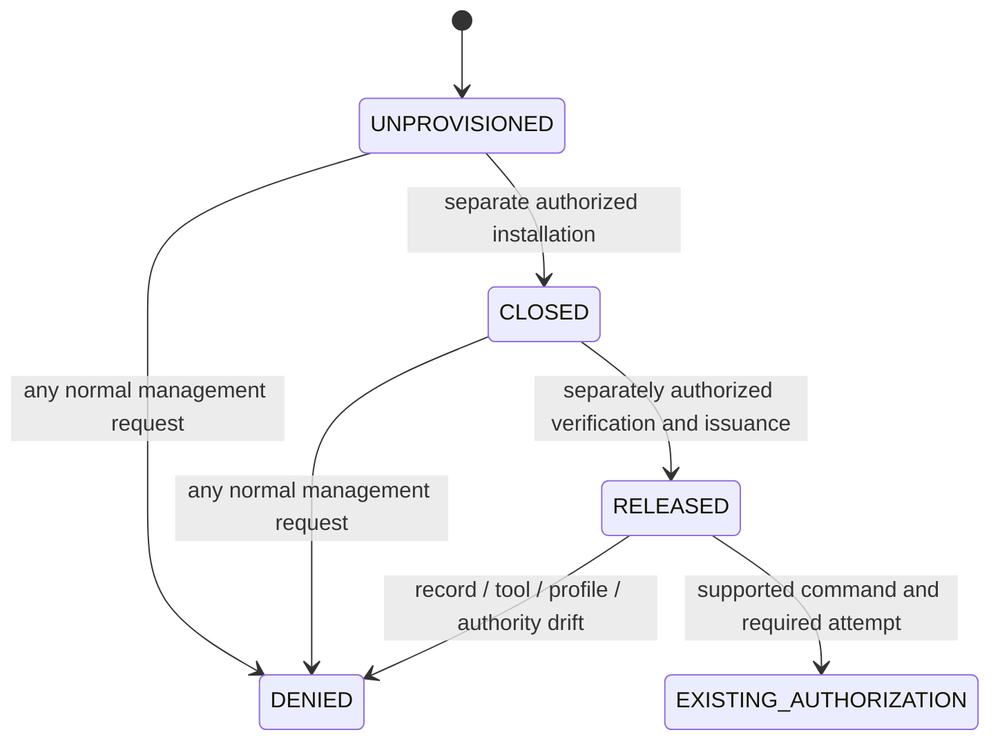

# B1-01 — Persistent bootstrap fence

Status: owner-authorized source implementation and synthetic acceptance scope.
Production **NO-GO**. This document authorizes no host installation, credential,
sudoers, systemd, backup, disposition, staging, re-seal or deployment operation.
Source baseline: `87f1b9d968a615ba1eaa5252165191660bf1ea6e` (origin/main checked
before starting). Acceptance results belong to the exact PR head and its CI.

The original B1-01 PR supplied only the reader/guard. The later
[B1-02 producer](b1-02-bootstrap-transition.md) implements separately authorized
CLOSED installation and RELEASED issuance without changing the record schemas
below. Its source acceptance does not authorize first activation on a host.

## 1. Boundary and threat model

The fence protects production **management orchestration** during an A+
fixed-path tool update. It is an additional prerequisite to existing R4,
forward-transition and emergency authorizations. It grants no deployment,
database, migration, start-budget or root-approval authority.

Root deliberately editing policy, invoking raw SQL, calling imported mutation
functions, executing an old tool or running systemctl is outside this threat
model. A root-owned program cannot constrain a deliberately overriding root
administrator. Delegated accounts must not have a shell, arbitrary sudo env/node,
systemctl, polkit management, writable tool directories or database maintenance
credentials through which they can bypass the reviewed fixed entrypoints.
Application credentials and normal application writes remain a separate boundary.

Initial installation therefore requires an independent, durable delegation
quarantine **before the first canonical file changes**, including old processes.
The source guard does not make old installed tools recognize a new record.
The procedure in section 5 remains an unexecuted production gate.

## 2. Persistent, hash-bound record contract

Fixed state directory: `/var/lib/servora-med/deploy/bootstrap`, physical,
`root:root 0700`. Every record is a regular `root:root 0600`, single-link file.
All ancestors must be physical, root-owned, and not group/other writable.

Each JSON file uses exactly `JSON.stringify({record, sha256}) + '\n'`, where
`sha256` hashes `JSON.stringify(record) + '\n'`. References between files hash
the **entire envelope bytes**. These hashes detect drift; root ownership is the
authority. This is not a cryptographic signature or protection from hostile root.

| File | Required binding |
|---|---|
| `closed.json` | `BOOTSTRAP_FENCE_CLOSED`, format 1, fence UUID, machine-id, manifest envelope SHA, stable host.lock device/inode |
| `manifest.json` | `BOOTSTRAP_MANAGEMENT_MANIFEST`, format 1, sorted unique tool path/mode/SHA entries |
| `verification.json` | `BOOTSTRAP_RELEASE_VERIFICATION`, exact closed/manifest/profile hashes and all eight verification checks |
| `release-authorization.json` | Separate `BOOTSTRAP_RELEASE_AUTHORIZATION`, exact closed/manifest/profile/verification hashes; scope `ENABLE_APPROVAL_GATED_MANAGEMENT` |
| `released.json` | `BOOTSTRAP_FENCE_RELEASED`, exact closed, owner authorization and verification envelope hashes |

`closed.json` and `manifest.json` are preserved when release evidence is added.
Missing state never means OPEN. `released.json` absent means CLOSED; a dangling
symlink is an existing untrusted object. Torn JSON, unknown keys/kinds/files,
temporary publication residue, foreign owners, mode changes, hardlinks, symlinked
ancestors, EACCES, ENOTDIR, EIO and hash mismatches all refuse. Reads use a
no-follow descriptor with before/opened/after/path metadata comparison. No reader
repairs, creates, deletes or reclaims a record or lock.

The minimum canonical tool closure is `REQUIRED_MANAGEMENT_FILES` in
`ops/scripts/bootstrap-fence.mjs`. An installation manifest must also include
**every active forward/emergency tool and its import closure** from the actual
host inventory. The minimum list alone does not prove that live delegation has
no additional entrypoint. Core and additional entries are rehashed at every
successful RELEASED guard invocation; the current protected profile bytes must
match the release authorization too. The existing empty root-owned host.lock
must retain its recorded device/inode; a missing or substituted lock is refused
before the legacy lock library could create one. Tool changes require a separately reviewed
future closure; an old release receipt cannot authorize drifted bytes.

Verification checks are: toolClosure, mutationCoverage, delegatedAccess,
noPendingOperation, historicalPreservation, canonicalTrustedTime,
profileContracts and serviceUnchanged. They are root attestations of independent
evidence, not checks that a caller can set using a CLI flag. A later release
issuer must actually perform and retain those checks, compare the nine live
profile contracts, verify effective authority and preserve historical evidence.
This PR deliberately provides **no record writer or release command**. The
fixture records are synthetic test inputs and must never be copied to a host.
An owner decision and a separately reviewed issuance/activation tool are needed
before production can reach RELEASED. Do not hand-author a receipt to skip that
gate. Approval/adoption/baseline and TT-A semantics are unchanged.



There is no expiry or boot-id rule that opens CLOSED. Losing flock, process
death, changing boot or waiting cannot create RELEASED. Unknown outcome remains
denied, with all bytes retained. There is no automatic retry-write, rollback,
receipt deletion, stale-state repair or implicit second installation.

## 3. Guard API and authorization after RELEASED

Production shell entrypoint:
`/usr/local/libexec/servora-med/bootstrap-fence <operation> [attempt-uuid]`.
Install as `root:root 0755`; its module is `root:root 0644`. The wrapper verifies
its trusted path, exact module SHA pin, Node ownership and physical ancestor
permissions, then runs with a clean environment. No path, UID, state, clock,
force, release or bootstrap-exception flag is accepted.

Node API: `assertBootstrapManagementAllowed(operation, attemptId)`. Synthetic
ports are exposed separately for tests; no production CLI argument selects one.
`withBootstrapMutationLock()` is for standalone preservation maintenance: it
opens the existing empty root-owned host.lock, obtains nonblocking flock, checks
the same inode and rechecks the persistent guard before the write. It cannot
create or reclaim the lock.

Normal deploy, postdeploy, attempt-preflight, forward-recovery, pre-migration-abort
and controller commands require an attempt UUID after RELEASED. A UUID itself
is not authority: existing controller code still loads and verifies the genuine
root approval/profile, time, phase, database and grant scopes. Helper phases
check the fence before lock acquisition and again while holding the stable lock.
Forward/emergency mutators also check before and after their existing lock.

Attempt-less host deployment, legacy deploy-release, generic rollback and
legacy in-place production restore remain disabled **after RELEASED**. Releasing
the fence does not restore those paths. Approved pre-migration abort and forward
recovery continue through their existing attempt contract. Any future
production restore needs a separately accepted authority integration; this PR
does not invent a restore approval or relax database safety.

## 4. Source inventory and coverage

| Management surface | Boundary / coverage |
|---|---|
| `ops/deploy-production.sh`, deploy workflow, SCP | Runner calls fixed helper. Attempt preflight precedes transfer for attempt-bound runs. Host guard remains authoritative; a legacy runner can leave an unprivileged `/var/tmp` transfer, but cannot activate it. No new remote grant. |
| `deploy-production-host`: deploy/postdeploy/rollback/forward-recovery/pre-migration-abort/attempt-preflight | Guard before and after host.lock. Only existing approved attempt paths are usable after RELEASED; rollback and attempt-less paths refuse. |
| `deployment-controller.mjs` CLI, including admit/event/barrier/backup/observe/abort/recover | Guard at CLI dispatch; existing approval/attempt checks continue. Direct imported functions are root administrator APIs, never delegated entrypoints. |
| `deploy-release.sh` | On an installed production host: always refuses `legacy-deploy`, including RELEASED. Historical non-host algorithm harness remains available only when all three fixed production roots are provably absent. |
| `production-recovery.sh` | Same installed-host check; legacy in-place restore remains disabled. TEST_DATABASE_URL cannot bypass an installed host fence. Explicitly non-host isolated recovery tests keep the original catalog/restore algorithm. |
| `forward-host.mjs`: apply/smoke/observe/finish/recover | Guard plus existing forward/recovery grant, artifact, phase, lock and budget. New dependency belongs to its sealed TOOL_FILES closure. |
| `emergency-handoff-host.mjs apply/preflight/verify`; `issue-emergency-handoff.mjs` | Guard plus existing emergency authority and lock. Parent checkpoint reads in preflight/verify can reconcile residue, so those paths are fenced too. Pure status stays readable. Artifact manifest includes the new module. |
| `preserve-forward-authorization.mjs` | Guard plus stable kernel lock around exact existing preservation. Existing immutable grant-copy semantics unchanged. |
| Both installed-OLD adoption shell CLIs | Guard under their existing root-only host lock. Adoption policy/record/one-shot/time semantics unchanged. |
| Root approval issuance and direct exported mutation APIs | Root administrator boundary, not a delegated general deployment API. No shell or arbitrary node sudo delegation is allowed. These must be explicitly excluded from normal management authorization during closure. |
| Disposition CLI, staging CLI, historical readback and separate profile-reseal | Separate root-only bootstrap authority, not a normal-manager guard exception. Existing OPS-R4-002/003/005/006 and re-seal policy unchanged. Exact operation needs separate owner approval while normal delegation is quarantined. No `--bootstrap` bypass. |
| Direct systemctl, sudoers/polkit/SSH/forced-command wrappers, old versioned tools, cron and timers launching management | Effective-host inventory and durable quarantine required. Source guards cannot cover an unmodified binary or a direct administrative route. Never restore general systemctl/shell grants after RELEASED. |
| Standalone node migrate, bootstrap-admin, onboarding/import and psql/pg_restore | Administrative credential execution, outside fixed delegated helper. Quarantine human/automation management access; do not change app DB roles/runtime in this PR. No blanket delegation of these commands. |
| BR7 disaster-recovery/restore rehearsal/DR acceptance CLI | Explicit isolated/new-target operator workflow; no authority to overwrite running production or manage its service. Not a fence exception for live-host restore. |
| Ordinary app/API/backup worker, health/alerting, HTTP reports | Runtime boundary; unchanged. The running service keeps operating. No fence added to service start conditions or health. |
| Scheduled backup timer → backup service → `backup-postgres.sh --trigger=scheduled` | Exempt runtime backup, unchanged script/unit/provenance. Manual/pre/post backup payloads also remain separate from host activation authority; starting administrative units through delegated systemctl is quarantined. |
| `_chrony` TT-A collector and existing forward start-gate | Existing runtime evidence/start-budget contract, unchanged. No management guard inserted into the runtime start-gate; no start budget reset. |

The fixed-root legacy probe uses lstat for `/opt/servora-med`,
`/etc/servora-med`, `/var/lib/servora-med`. Any existing object, dangling link,
EACCES, ENOTDIR, failed Node execution or other uncertainty selects the guarded
installed-host path. Only ENOENT for **all** roots permits the non-host
algorithm. Neither caller paths nor a test environment variable can override
the physical host. This distinction preserves isolated restore tests without
opening a production path when only the bootstrap directory is missing.

## 5. First activation protocol — not yet executed or install-authorized

1. Freeze a new reviewed exact-main, successful exact-SHA CI and new Linux
   artifact. The old `87f1b9d` tarball cannot contain B1-01. Inventory effective
   sudoers includes/digests, polkit, SSH forced commands, service-manager grants,
   old scripts/versioned tools, management cron/timers, CI credentials and all
   currently running management processes. Unknown scope means STOP.
2. Under separate owner authority, establish a **persistent external
   quarantine** of every non-root management route before touching canonical
   tools. Merely disabling a GitHub workflow, holding flock, setting an env var,
   writing a record unknown to old tools or promising not to run a command is
   insufficient. Keep the existing application, its runtime start policy,
   scheduled backup and collector working. Evaluate any required sudoers/SSH/
   systemd policy change separately; this PR neither installs nor supplies one.
   For the narrow host topology with **only one delegated fixed helper**, the
   concrete quarantine candidate is an atomic root-owned replacement of that
   helper by an unconditional deny launcher. Its entire behavior is to print
   `BOOTSTRAP_MANAGEMENT_QUARANTINED` and exit 1 for every argument. Publish it
   from a same-directory exclusive temporary file, verify root:root 0755/nlink 1,
   fsync, compare the original helper inode/hash, rename and fsync the directory;
   retain the original bytes and before/after manifest outside the live path.
   This is itself the **first separately authorized management-policy write**;
   it precedes every other canonical tool replacement. It needs proof that all
   already-running delegated processes have drained and that the old helper
   really holds the same stable lock before any effect. Recheck under that lock.
   A profile mismatch is not used as the quarantine. Persisted denial survives
   process death/reboot and does not alter the app unit or backup timer.
   Replace that deny launcher only after CLOSED and the reviewed guard/callers
   are installed. If effective delegation includes another helper, direct
   systemctl, shell, sudo env/node, polkit or autonomous management unit, this
   one-path candidate is insufficient: STOP until a separately reviewed durable
   closure covers **every** route. No production deny launcher or policy patch
   is shipped or installed by B1-01.
3. Verify the quarantine with the actual delegated identities and across reboot
   in a disposable equivalent environment. Establish quiescence: no retained
   root shell/controller/CI/maintenance operation may still mutate. Acquire
   the **existing** trusted stable host.lock under the separately authorized
   installer; never replace it. Recheck pending markers, initialization slots,
   current/profile/approval/baseline/historical hashes and runtime identity.
4. Verify an isolated root-owned prepared tool set and its complete manifest.
   Publish the new CLOSED records exclusively and durably (file fsync and
   directory fsync) while external quarantine remains in force. B1-01 has no
   production writer; a separately reviewed issuer must implement this step.
   At this point old tools are still fenced by external quarantine, not by
   their understanding of CLOSED.
5. Install the reviewed guard and callers under that quarantine and host lock.
   Sequential canonical replacements are not globally atomic. CLOSED and the
   external quarantine prevent normal management during partial installation.
   Preserve the current release/symlink, profile and all historical evidence.
   No restart, migration, new backup or systemd reload is part of this slice.
6. On crash, reboot, ENOSPC, EIO or any uncertain readback: remain quarantined
   and CLOSED, retain partial bytes and record the exact installed manifest.
   Release of flock cannot open management. Do not auto-rollback, rewrite a
   receipt, repair the profile or attempt a second install. A new reviewed
   deterministic recovery plan must bind the observed partial installation.
7. Complete independently authorized historical preservation and profile work
   using only the exact separately approved root tools. They do not receive
   normal manager privileges or an automatic grant from CLOSED.
8. Before separate release authorization, independently verify the complete
   active tool closure; nine host profile contracts; root record/link/permission
   integrity; all pending markers/initializations; canonical TT-A v2 and effective
   collector; historical 26-source preservation; unchanged service/current; and
   effective delegated scope. Retain actual readback evidence. Release issuance
   must bind that evidence and owner approval to this exact closed record.
9. After a separately reviewed RELEASED publication, permit only the new fixed
   guarded helper with validated arguments. Do not restore legacy deployment,
   arbitrary systemctl/node/env/shell, old wrappers or earlier tool paths.
   Exercise delegated negative checks again. Genuine deployment still requires
   its existing fresh root approval and accepted attempt authority.

No command in this protocol has been executed on production. There is no
ready-to-run first-activation/quarantine installer in this PR. Until its real
effective scope and crash/reboot behavior are accepted, **production remains
NO-GO**, even if this guard's source CI is green.

Common `/usr/local/libexec/servora-med` remains root-owned **0755** so `_chrony`
can traverse and read canonical `trusted-time.mjs`. The separate
`/usr/local/libexec/servora-med-profile-reseal` directory remains **0750**.
Release-directory root/group 0750 rules are a separate contract. This PR changes
none of those permissions, collector units, lock-library bytes or re-seal tools.

## 6. Acceptance and evidence limits

| Scenario | Verification |
|---|---|
| Missing/closed/unknown state; torn records; foreign owner/mode; symlinks; hardlinks; wrong hash; partial tools | Synthetic guard tests plus fixed-path disposable Linux tests |
| EACCES/ENOTDIR/EIO/ENOSPC reads | Injected read faults; refusal without write/repair. Not a claim of real disk failure acceptance. |
| Process death releases flock without releasing fence | Actual Linux child SIGKILL and fresh CLI reads in a disposable container |
| Reboot/changed boot cannot open CLOSED | Synthetic port changes boot/time and reconstructs the reader; fresh process reads retained records. Real VM/kernel reboot acceptance remains NOT_RUN here. |
| RELEASED without owner/verification/profile/tool match | Synthetic negatives and Linux canonical readback |
| RELEASED without an attempt/real approval | Actual helper refusal and actual controller refusal with a valid-looking UUID and no approval |
| Legacy deploy/rollback/restore after RELEASED | Fixed-path executable Linux negatives, including a test DB selector |
| Service and scheduled backup preservation | Source contract tests, unchanged unit/script diffs, existing server backup regressions; a synthetic runtime child remains alive. Real systemd/Chrony/timer acceptance is a separate gate. |
| History/current/profile untouched | 26 synthetic historical sentinel hashes/metadata, profile bytes and current link compared before/after Linux negatives |
| Real effective first quarantine, initial record issuance and release | NOT_RUN / separate implementation and owner authorization required |

Hosted CI runs the new guard tests and a root **disposable container** with no
network and a read-only source bind mount inside the required server job. The
ordinary server/web/security jobs remain required. No mandatory duplicate full
27-gate local run is added. If local CI is used as a future release fallback,
retain this additional Linux acceptance output too; a skipped container test
cannot be described as PASS.

Local commands (Node 22):

```text
node --test ops/tests/bootstrap-fence.test.mjs ops/tests/bootstrap-fence-reader.test.mjs ops/tests/bootstrap-fence-coverage.test.mjs
shellcheck -x ops/scripts/bootstrap-fence.sh ops/scripts/deploy-production-host.sh ops/scripts/deploy-release.sh ops/scripts/production-recovery.sh
```

Only on an owned disposable container, never production:

```text
docker run --rm --network none --mount type=bind,source=<exact-source>,target=/source,readonly --workdir /source --env BOOTSTRAP_FENCE_CONTAINER_TEST=1 node:22-bookworm node --test ops/tests/bootstrap-fence-linux.test.mjs
```

Security review can accept the source component separately from production
activation. Adoption succession, approval expiry remediation, artifact retention
redesign, historical-policy changes and re-seal changes are outside B1-01.
